# 微信输入法 Android 4.0.0 REA 逆向分析与复刻蓝图

> 交互版：[analysis.html](analysis.html)（图谱、键盘预览、105 张截图画廊、灯箱）  
> 本文：可检索、可 diff 的 Markdown 版本。图表文件在 `assets/`，截图在 `assets/images/`。


**目标包**：`com.tencent.wetype` · 版本 `4.0.0`（versionCode `57206`）  
**APK SHA-256**：`0c6b020479827cf601a2aae559f1d9138fd70712570f0bb897620be7cafde7f2` · **大小**：227,648,847 字节  
**分析日期**：2026-10-20 · **报告版本**：v1（分析基线）  
**结论**：Android 首页/设置/键盘/原生功能的可复核结构已经恢复；官方云服务不可获得；iOS 无 IPA，不能做二进制级静态分析。复刻将按“自有后端 + 本地引擎”实现。

> 本报告把 **REA 静态证据**、**原版运行截图**、**APK 内资源**、**公开 iOS 可见界面** 和 **复刻自测** 分开记录。任何一类材料都不能替代另一类。所有结论附 Evidence ID 或原始文件路径。

## 0. 一页结论

<div class="metrics">
<div><strong>13,585</strong><span>APK 类总数</span></div>
<div><strong>1,890</strong><span>com.tencent.wetype 类</span></div>
<div><strong>36</strong><span>键盘布局 JSON</span></div>
<div><strong>586</strong><span>中文 string 资源</span></div>
<div><strong>28</strong><span>RN 注册模块</span></div>
<div><strong>28</strong><span>SchemeAction</span></div>
</div>

- **已恢复**：首页 RN 注册表、28 个 SchemeAction、36 套键盘布局、53 个应用组件、37 个主设置字段及 5 个子模型、586 条中文资源、AI/语音/同步/迁移的协议入口、`wetype://` 深链行为。
- **已运行验证**：原版 4.0.0 在独立 Android AVD 上完成隐私接受、首页、布局/按键/辅助输入/语音/Plus/单机/隐私/关于/帮助、键盘管理、AI 录音笔、隔空传送、深链等页面采集；历史 42 步 + 本轮 39 张运行截图。
- **未恢复**：腾讯私有云 API 的 base URL、鉴权、签名、模型与提示词；拼音/五笔/手写/语音的私有算法与模型；iOS 二进制。
- **复刻决策**：Flutter 通用版 + Android 原生 IME + iOS 原生键盘扩展，共用一套布局/词库/设计规格；AI、ASR、翻译、同步、传送走可配置的自有后端，密钥只在服务端。
- **关键限制**：Android 官方后端不可用，不能把“原版联网功能”当作可复现依赖；iOS 只能依据可见界面和 Android 证据重建，不能宣称二进制级同构。

## 1. 对象、工具与方法

### 1.1 包身份

| 项目 | 值 |
|---|---|
| 包名 | `com.tencent.wetype` |
| 版本 | 4.0.0 / 57206 |
| minSdk / targetSdk | 24 / 35 |
| APK 字节 | 227,648,847 |
| SHA-256 | `0c6b020479827cf601a2aae559f1d9138fd70712570f0bb897620be7cafde7f2` |
| 权限数 | 31 |
| 应用组件 | 53 |
| Hermes bundles | feedback.hbc、general.hbc、platform.hbc、setup.hbc |
| arm64 原生库 | 57 |

权限覆盖网络、录音、相机、短信、附近 Wi-Fi、悬浮窗、前台服务、通知等。它们解释了为什么原版可以在键盘内直接做语音、扫码、文件传送和跨设备发现；复刻版必须逐项按平台权限模型重新申请，不能照搬 manifest。

### 1.2 实际使用的工具链

| 工具 | 版本/角色 | 用途 |
|---|---|---|
| REA CLI | `rea-agents 6.7.0` | Android 包/类/方法查询；生成 Evidence JSON |
| JADX headless bridge | `0.7.1`，SHA-256 `6e5eacf5…` | `inspect-android-package/class/method`、类清单、方法正文 |
| apktool | `2.11.1` | manifest、资源、assets、smali 入口 |
| hermes-dec | Python 3.14 venv | 解包 `setup/general/feedback/platform.hbc` 为可检索伪 JS |
| Graphviz | `dot` | 架构图、路由图、状态机、AI 流程图 |
| adb + AVD | `WeChatInput_API_36` / `WeChatInput_Tablet_API_36` | 原版运行截图；后续复刻验收 |

### 1.3 证据分层

| 层 | 能证明什么 | 不能证明什么 |
|---|---|---|
| REA 静态 | 类/方法/字段/调用确实存在于 APK；selector 与 Evidence ID 可复核 | 分支在当前设备/账号/网络下一定执行 |
| 原版运行截图 | 当时设备上可见的页面、文案、状态与跳转结果 | 其他版本、深色模式、平板布局、未进入的分支 |
| APK 内资源 | 36 套键盘的几何/文本/样式引用；586 条中文串 | 运行时的实际渲染与候选结果 |
| 公开 iOS 可见界面 | iOS 3.5.5 在 iPhone Mirroring 中可见的页面与文案 | iOS 二进制结构、扩展实现、私有 API |
| 复刻自测 | 复刻版在指定构建/设备上的行为 | 与原版逐像素/逐算法一致 |

### 1.4 复现命令

```bash
export REA_JADX_MCP_JAR="$PWD/rea/tooling/jadx-headless-mcp-0.7.1-all.jar"
export REA_APKTOOL_COMMAND="$PWD/rea/tooling/apktool.sh"
rea inspect-android-package targets/wechat-android-4.0.0.apk --format json
rea search-android-classes targets/wechat-android-4.0.0.apk "" --format json
rea inspect-android-class targets/wechat-android-4.0.0.apk \
  com.tencent.wetype.plugin.hld.reactnative.activity.ImeMainSettingActivity --format json
rea inspect-android-method targets/wechat-android-4.0.0.apk \
  com.tencent.wetype.plugin.hld.reactnative.activity.ImeMainSettingActivity R1 --overload-index 0 --format json
```

```bash
python3 scripts/normalize_analysis.py
python3 scripts/build_diagrams.py
python3 scripts/prepare_report_assets.py
python3 scripts/build_report.py
```

## 2. 架构：三层 + 一个不可用云

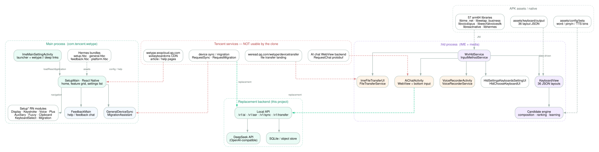

原版不是单一 RN 应用，而是 **主进程 RN 设置界面 + `:hld` 进程原生输入法 + 原生媒体/传送/AI WebView** 的组合：

1. **主进程**：`ImeMainSettingActivity` 是 launcher，接收 `wetype://`；`SetupMain` 及各 `Setup*` 页面来自 `setup.hbc`；`GeneralDeviceSync`、`MigrationAssistant`、`FeedbackMain` 来自 `general.hbc` / `feedback.hbc`。
2. **`:hld` 进程**：`WxHldService` 是真正的 `InputMethodService`；键盘视图、候选引擎、录音笔、文件传送、AI 聊天、键盘管理都在这里或其相邻原生页面。
3. **原生库/资源**：57 个 arm64 `.so`，包括 `libime_net.so`、`libwetap_business.so`、`libvoiceopus.so`、`libwechatvoicesilk.so`、`libreactnative.so`、`libhermes.so`；36 套键盘 JSON 与词库/配置 bin。
4. **腾讯云**：文章/帮助 CDN、设备同步、迁移、AI Chat WebView、文件传送落地页。客户端代码中没有可复用的公开 AI base URL；这条链路被标记为**不可用**。
5. **替代后端**：本地 API 代理 DeepSeek，提供 AI/ASR/翻译/同步/传送；客户端只配置 `API_BASE_URL`。

### 2.1 RN bundle 与注册模块

| Bundle | 文件 | 注册模块数 | 代表模块 |
|---|---|---|---|
| `setup` | `setup.hbc` (2.1 MB) | 20 | SetupMain / SetupPlus / SetupDisplaySetting / SetupVoiceInput / SetupSecondaryKeyboard / SetupMigrationAssistant |
| `general` | `general.hbc` (923 KB) | 3 | GeneralDeviceSync / GeneralDeviceSyncCodeInput / General_MigrationAssistant |
| `feedback` | `feedback.hbc` (862 KB) | 1 | FeedbackMain |
| `platform` | `platform.hbc` (912 KB) | 0 | 共享平台运行时 |

`setup.js` 的注册表明确给出 `SetupMain`、`SetupPlus`、`SetupDesktop`、`SetupKeyboardSelect`、`SetupSp`、`SetupWb`、`SetupClipboard`、`SetupVoiceInput`、`SetupDisplaySetting`、`SetupKeystrokeEffect`、`SetupAuxiliaryInput`、`SetupLanguageRecognizeInVoice`、`SetupRecordingStandbyTime`、`SetupShowVoiceIconInVoiceInput`、`SetupPunctuationSettingInVoiceInput`、`SetupFuzzyPinyin`、`SetupSecondaryKeyboard`、`SetupMigrationAssistant`、`FeedbackMain`、`GeneralDeviceSync`、`GeneralDeviceSyncCodeInput`、`General_MigrationAssistant`、`SetupTest`、`SetupLottieExample`、`About_About`、`Unknown_Unknown`、`AIChat_RNAiChatPage`。这是**页面身份**，不是组件树。

### 2.2 关键组件

| 组件 | 类型 | 进程 | 导出 | 说明 |
|---|---|---|---|---|
| ImeMainSettingActivity | activity | main | true | — |
| HldActivationUI | activity | main | false | — |
| HldSettingsInputUI | activity | main | false | — |
| HldSettingsKeyboardsSettingUI | activity | main | false | — |
| HldSettingsAboutUI | activity | main | false | — |
| HldStandaloneModeUI | activity | main | false | — |
| HldQRScannerUI | activity | main | false | — |
| SimpleReactActivity | activity | main | false | — |
| ImeTryEditUI | activity | main | false | — |
| HldWebViewUI | activity | main | false | — |
| AiChatActivity | activity | main | false | — |
| VoiceRecorderActivity | activity | main | false | — |
| VoiceRecorderSessionActivity | activity | main | false | — |
| HldPrivacyInfoUI | activity | main | false | — |
| HldChooseKeyboardUI | activity | main | false | — |
| HldPermissionSettingUI | activity | main | false | — |
| HldFeedbackUI | activity | main | false | — |
| FeedbackChatActivity | activity | main | false | — |
| FileTransferShareEntryActivity | activity | main | true | — |
| ImeFileTransferUI | activity | main | false | — |
| WxHldService | service | :hld | true | android.permission.BIND_INPUT_METHOD |
| VoiceRecorderService | service | main | false | — |
| VoiceRecorderCaptureService | service | :hld | false | — |

### 2.3 深链与路由行为

`ImeMainSettingActivity.R1`（Evidence `ev_2fb38fa49b8a4266e`）只对两个 host 做原生特判：

- `launchFileTransfer` → `scheme.c.z(...)` → `ImeFileTransferUI`
- `voiceRecorder` → `scheme.c.z(...)` → `VoiceRecorderActivity`

其余 URI 由 `y1(uri)` 解析为 JSON，再交给 RN 事件总线 `g.f37567a.g(json)`；`WBRCTNavigator.navigate/navigateWithInfo` 在本包静态正文中直接 reject `UNSUPPORTED`，`navigateToURL` 才向 UI 线程提交 runnable。**不能假设任意 RN dest 都可导航。**

已实际验证：

```bash
adb shell am start -a android.intent.action.VIEW -d "wetype://voiceRecorder"
# → VoiceRecorderActivity
adb shell am start -a android.intent.action.VIEW -d "wetype://launchFileTransfer"
# → ImeFileTransferUI
adb shell am start -a android.intent.action.VIEW -d "wetype://aiChat"
# → 回到 ImeMainSettingActivity；无参数时不直接进入聊天
```

### 2.4 SchemeAction 全表

| Key | 值 | 页面 | 行为 |
|---|---|---|---|
| MainSetting | mainSetting | 主设置/首页 | 切入 RN SetupMain |
| KeyboardSetting | keyboardSetting | 键盘设置 | RN 页面 |
| VoiceInputSetting | voiceInputSetting | 语音输入设置 | RN 页面 |
| VibrateVolumeSetting | vibrateVolumeSetting | 按键效果 | RN 页面 |
| DisplaySetting | displaySetting | 布局和显示 | RN 页面 |
| KeyboardAppearanceSetting | keyboardAppearanceSetting | 键盘外观 | RN 页面 |
| FuzzyPinyinSetting | fuzzyPinyinSetting | 模糊拼音 | RN 页面 |
| SlideInputSetting | slideInputSetting | 上滑输入 | RN 页面 |
| T9CustomSymbolSetting | t9CustomSymbolSetting | 九宫格符号自定义 | RN 页面 |
| PlusSetting | plusSetting | 拼写 Plus | RN 页面 |
| PermissionAndPrivacySetting | permissionAndPrivacySetting | 隐私与权限 | RN 页面 |
| HelpAndFeedback | helpAndFeedback | 帮助与反馈 | RN FeedbackMain |
| About | about | 关于 | RN About |
| Debug | debug | 调试 | 内部页面 |
| TestView | testView | 测试视图 | 内部页面 |
| Feedback | feedback | 反馈 | RN FeedbackMain |
| Rating | rating | 评分 | 系统/应用内评分 |
| Web | web | WebView | 帮助/文章 |
| ExperienceKeyboard | experienceKeyboard | 体验键盘 | 键盘试用 |
| DeviceSync | rctView?bundleName=general&moduleName=GeneralDeviceSync | 跨设备同步 | GeneralDeviceSync |
| SetupClipboard | rctView?bundleName=setup&moduleName=SetupClipboard | 剪贴板 | SetupClipboard |
| VoicePunctuationSetting | voicePunctuationSetting | 标点设置 | Voice 子页 |
| VoiceShowIconSetting | voiceShowIconSetting | 语音图标 | Voice 子页 |
| StandaloneMode | standaloneMode | 单机模式 | 原生 HldStandaloneModeUI |
| QR_SCAN | qrScan | 扫码 | HldQRScannerUI |
| AiChat | aiChat | 问 AI | AiChatActivity WebView |
| VoiceRecorder | voiceRecorder | AI 录音笔 | 原生 VoiceRecorderActivity |
| FileTransfer | launchFileTransfer | 隔空传送 | 原生 ImeFileTransferUI |

## 3. 页面与跳转地图

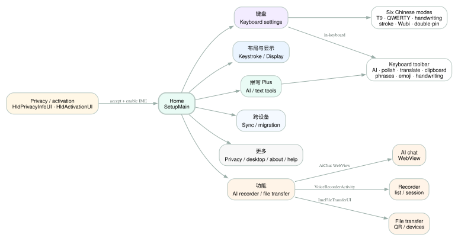

### 3.1 页面清单（按运行可达性）

| 页面 | 类型 | 入口 | 运行证据 | 复刻优先级 |
|---|---|---|---|---|
| 隐私说明 `HldPrivacyInfoUI` | 原生 | 首次启动 | `00-launch` / `10-privacy` | P0 |
| 启用引导 `HldActivationUI` | 原生 | 隐私后/未启用 | `01-home`（历史） | P0 |
| 首页 `SetupMain` | RN | launcher | `21-home-top` / `22-home-mid` / `23-home-bottom` | P0 |
| 布局和显示 `SetupDisplaySetting` | RN | 首页 | `30`–`32` | P0 |
| 按键效果 `SetupKeystrokeEffect` | RN | 首页 | `33`–`34` | P0 |
| 定制工具栏 `SetupSecondaryKeyboard` | RN | 首页 | `35` | P1 |
| 辅助输入 `SetupAuxiliaryInput` | RN | 首页 | `36`–`37` | P0 |
| 模糊拼音 `SetupFuzzyPinyin` | RN | 辅助输入 | 静态/字符串 | P1 |
| 跨设备粘贴同步 `GeneralDeviceSync` | RN | 首页 | `38` | P1 |
| 剪贴板 `SetupClipboard` | RN | 首页 | `39` | P0 |
| 键盘管理 `HldSettingsKeyboardsSettingUI` | 原生 | 首页 | `40` | P0 |
| 键盘选择 `HldChooseKeyboardUI` | 原生 | 键盘管理 | `keyboard-modes` | P0 |
| 语音转文字 `SetupVoiceInput` | RN | 首页 | `41`–`42` | P0 |
| 识别语言 `SetupLanguageRecognizeInVoice` | RN | 语音 | 字符串/路由 | P1 |
| 标点设置 `SetupPunctuationSettingInVoiceInput` | RN | 语音 | 字符串/路由 | P1 |
| 录音待机 `SetupRecordingStandbyTime` | RN | 语音 | 字符串/路由 | P2 |
| 语音图标 `SetupShowVoiceIconInVoiceInput` | RN | 语音 | 字符串/路由 | P2 |
| 拼写 Plus `SetupPlus` | RN | 首页 | `43`–`44` | P0 |
| 单机模式 `HldStandaloneModeUI` | 原生 | 首页 | `45` | P0 |
| 换机助手 `SetupMigrationAssistant` | RN | 首页 | `46` | P2 |
| 隐私与权限 `PermissionAndPrivacySetting` | RN | 更多 | `50` | P0 |
| 电脑版 `SetupDesktop` | RN | 更多 | `51` | P2 |
| 关于 `About` | RN/原生 | 更多 | `52` | P2 |
| 帮助与反馈 `FeedbackMain` | RN | 更多 | `53` | P1 |
| AI 录音笔 `VoiceRecorderActivity` | 原生 | 首页/深链 | `60` / `deeplink…voiceRecorder` | P0 |
| 录音会话 `VoiceRecorderSessionActivity` | 原生 | 录音笔 | 路由/Manifest | P1 |
| 隔空传送 `ImeFileTransferUI` | 原生 | 首页/深链 | `61` / `deeplink…launchFileTransfer` | P1 |
| 问 AI `AiChatActivity` | 原生 WebView | 键盘/首页 | `70` / `71` | P0 |
| 键盘工具栏 | 原生 IME | 键盘 | 历史 `tools-panel` / `30`–`32` | P0 |
| 反馈会话 `FeedbackChatActivity` | 原生 | 帮助 | `53` | P1 |
| 文件分享入口 `FileTransferShareEntryActivity` | 原生 | 系统分享 | Manifest | P2 |

### 3.2 深入路由

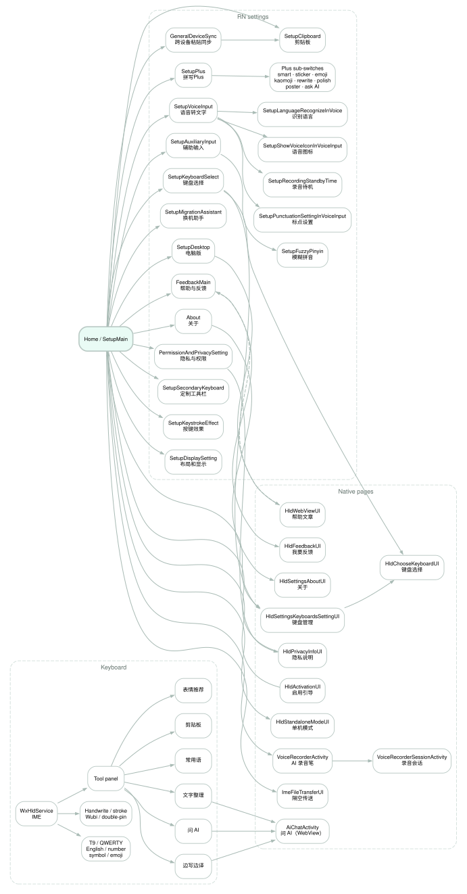

### 3.3 运行截图画廊

> 2026-10-18 的 42 步截图来自同一 SHA-256 的 APK，使用独立 AVD；2026-10-20 的截图在新建的 `WeChatInput_API_36` 上复采。历史截图只作为“当时可见状态”的证据，不替代本轮静态结论。iOS 小节中的图片是 iPhone Mirroring 的可见界面，不是 iOS 二进制分析。

#### Android · 2026-10-18（42 步）

**首次启动：启用引导（第一步/第二步）**

[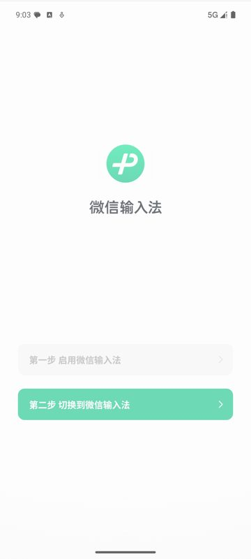](assets/images/android-20261018/01-home.png)

**系统输入法选择器：Gboard / 微信输入法 / 轻语输入法**

[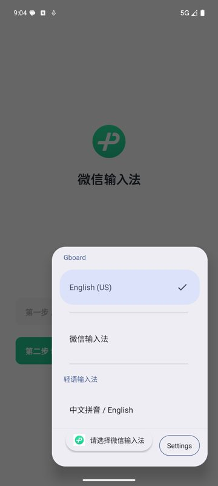](assets/images/android-20261018/02-ime-picker.png)

**首页：文字整理轮播卡 + 功能/设置分组**

[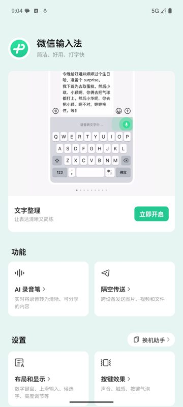](assets/images/android-20261018/03-home.png)

**AI 录音笔入口：录音精准转写 · AI 实时总结**

[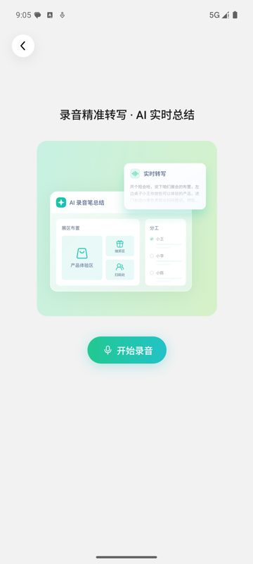](assets/images/android-20261018/04-ai-recorder-entry.png)

**首页：问 AI 轮播卡（支持 DeepSeek-R1 文案）**

[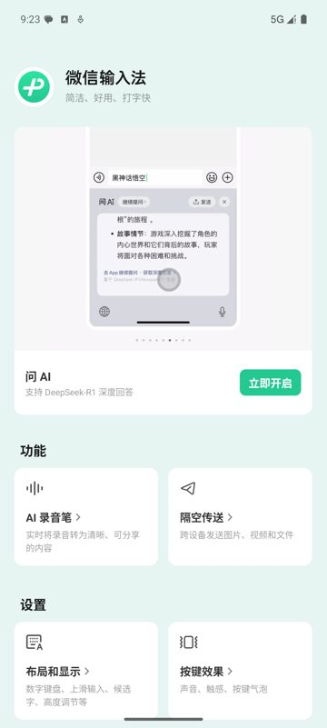](assets/images/android-20261018/05-home-return.png)

**首页设置区：布局/按键/工具栏/辅助输入/跨设备/剪贴板**

[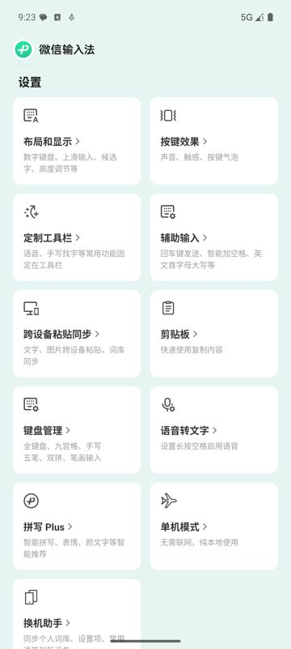](assets/images/android-20261018/06-home-settings.png)

**布局和显示：候选字大小、数字键盘、上滑输入、Emoji**

[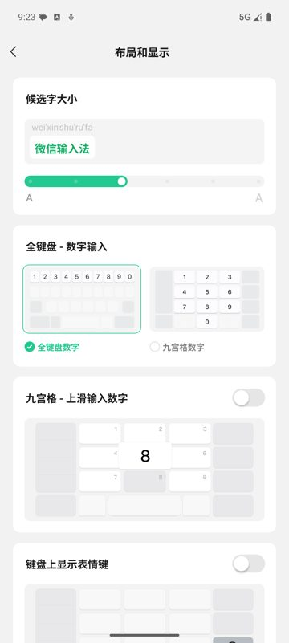](assets/images/android-20261018/07-layout-display.png)

**布局和显示：键盘高度、九宫格侧边栏、深色模式**

[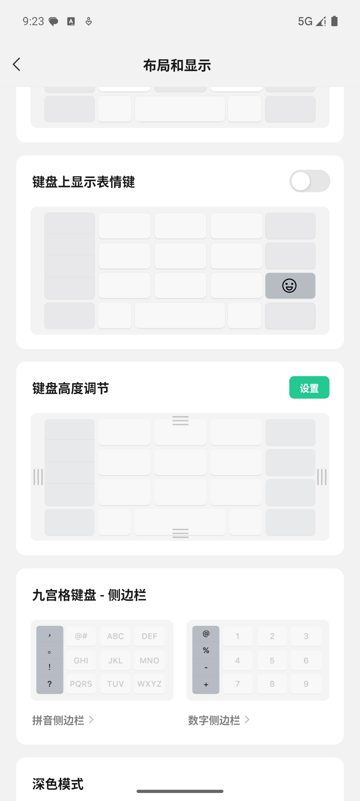](assets/images/android-20261018/08-layout-display-bottom.png)

**布局和显示：主题模式、拼音显示位置**

[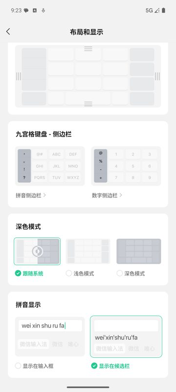](assets/images/android-20261018/09-layout-display-end.png)

**返回首页并保持滚动位置**

[](assets/images/android-20261018/10-home-settings-return.png)

**按键效果：声音、触感强度、按键气泡**

[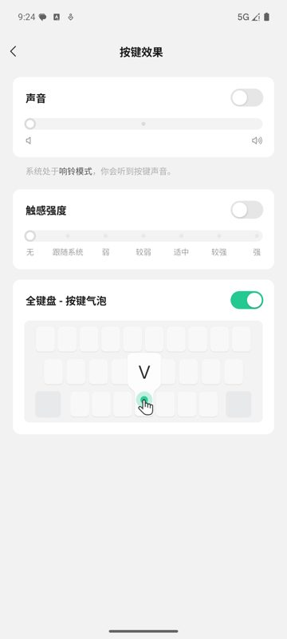](assets/images/android-20261018/11-key-effects.png)

**首页下半：辅助输入、跨设备、剪贴板、键盘管理**

[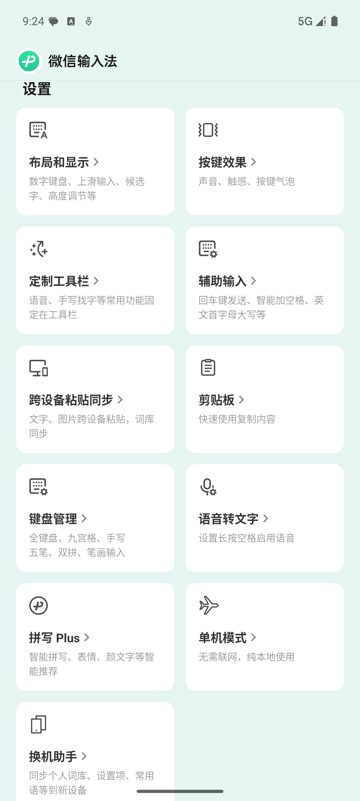](assets/images/android-20261018/12-home-bottom.png)

**首页底部：更多入口（隐私、电脑版、关于、帮助与反馈）**

[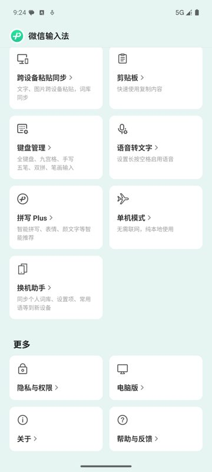](assets/images/android-20261018/13-home-end.png)

**语音转文字设置：标点、长按空格、松手发送、智能整理、离线语音**

[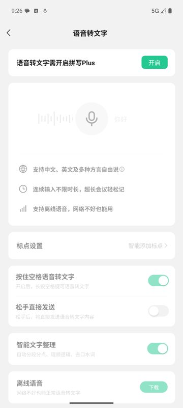](assets/images/android-20261018/14-speech-settings.png)

**首页：拼写 Plus 入口与设置项**

[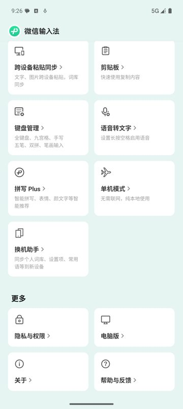](assets/images/android-20261018/15-home-before-plus.png)

**拼写 Plus：智能拼写、小程序、表情包、Emoji、颜文字、拼写检查、灵动表达等**

[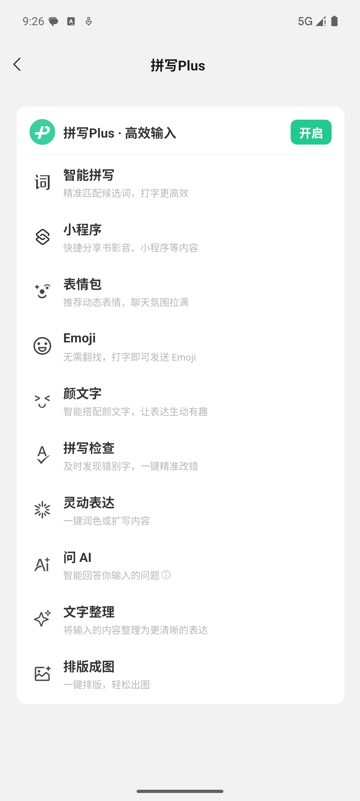](assets/images/android-20261018/16-plus-settings.png)

**从拼写 Plus 返回首页**

[](assets/images/android-20261018/17-home-return.png)

**单机模式：无需联网、下载本地词库与离线语音模型**

[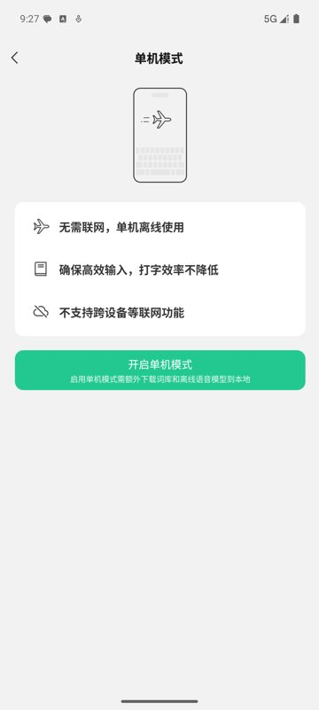](assets/images/android-20261018/18-offline-mode.png)

**从单机模式返回首页**

[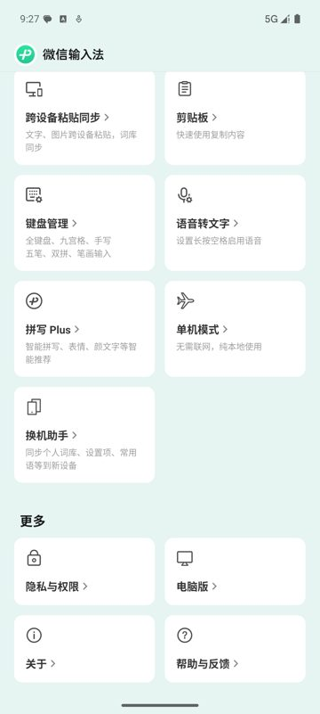](assets/images/android-20261018/19-home-return.png)

**隐私与权限：输入法状态、个人词典、麦克风等**

[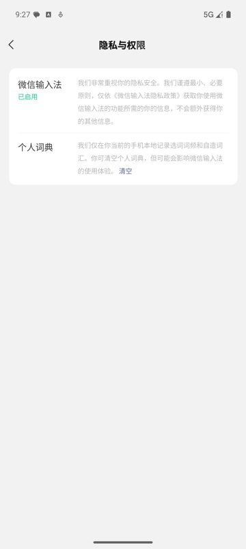](assets/images/android-20261018/20-privacy-permissions.png)

**从隐私与权限返回首页**

[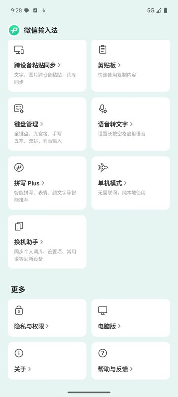](assets/images/android-20261018/21-home-return.png)

**首页：辅助输入入口**

[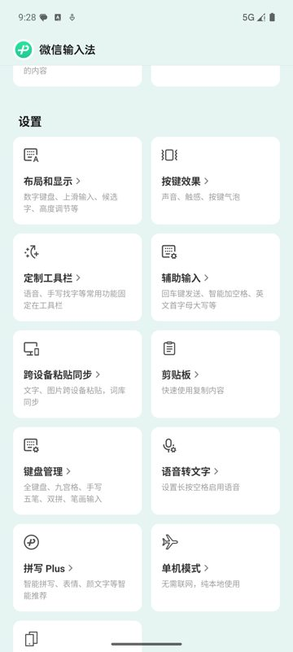](assets/images/android-20261018/22-home-assist-entry.png)

**辅助输入：回车发送、中英文/数字间空格、验证码**

[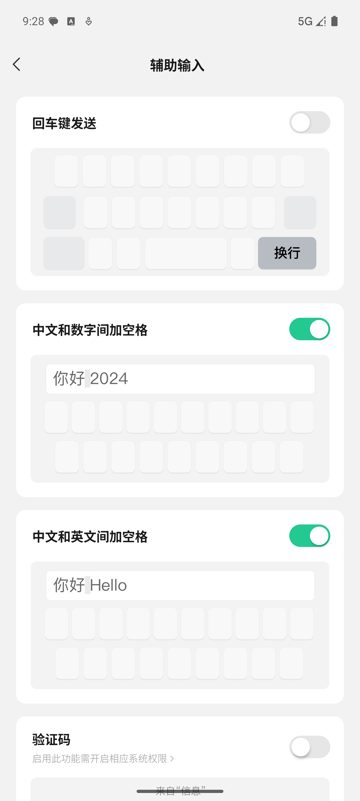](assets/images/android-20261018/23-assist-input.png)

**辅助输入：首字母大写、双击空格句号、模糊拼音**

[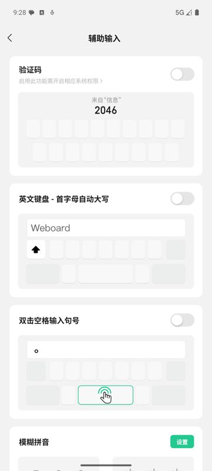](assets/images/android-20261018/24-assist-input-bottom.png)

**键盘与同一宿主：候选上屏结果**

[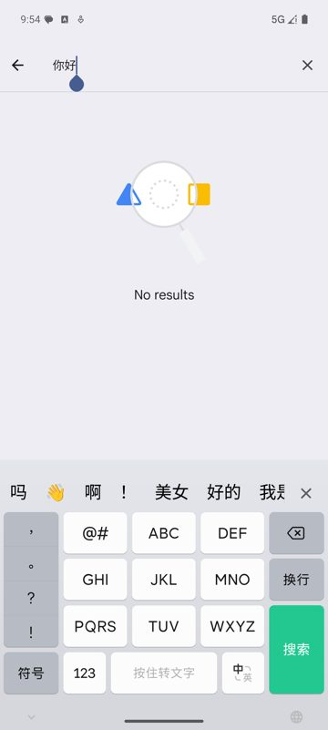](assets/images/android-20261018/25-keyboard-same-host.png)

**空输入状态下的键盘与候选栏**

[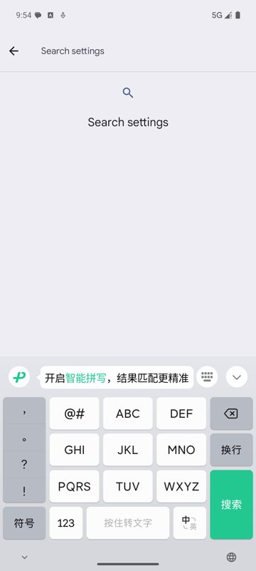](assets/images/android-20261018/26-keyboard-empty-current.png)

**键盘工具栏第一页**

[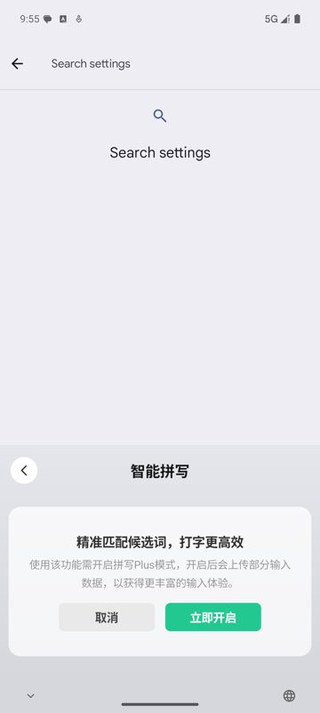](assets/images/android-20261018/27-tools-page-one.png)

**键盘工具栏第二页**

[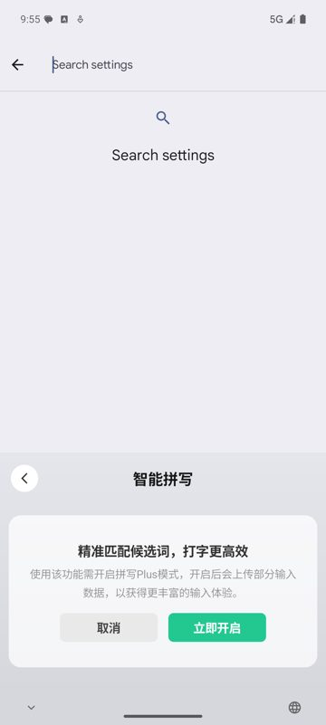](assets/images/android-20261018/28-tools-page-two.png)

**关闭工具栏后的宿主状态**

[](assets/images/android-20261018/29-tools-after-cancel.png)

**键盘工具栏第二页（实际页次）**

[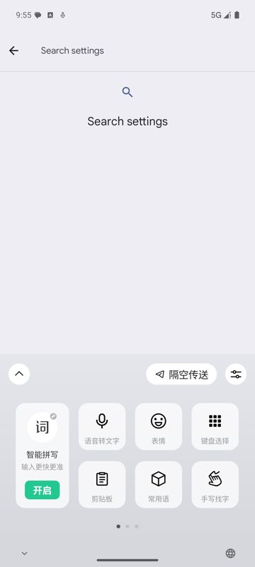](assets/images/android-20261018/30-tools-second-page.png)

**键盘工具栏第三页**

[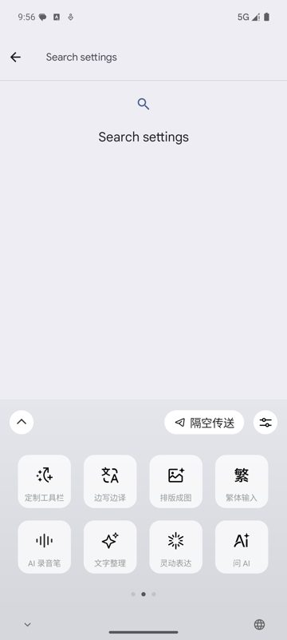](assets/images/android-20261018/31-tools-third-page.png)

**键盘工具栏最后一页**

[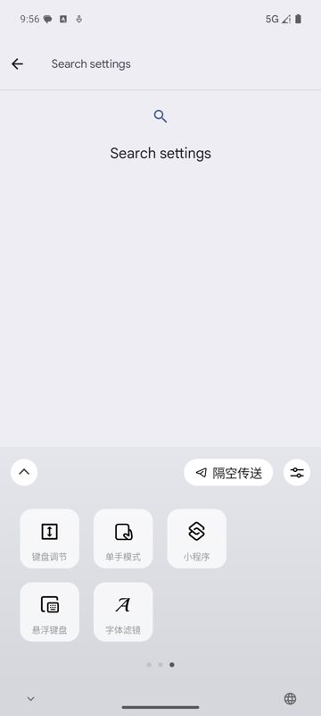](assets/images/android-20261018/32-tools-last-page.png)

**首页轮播 01：文字整理**

[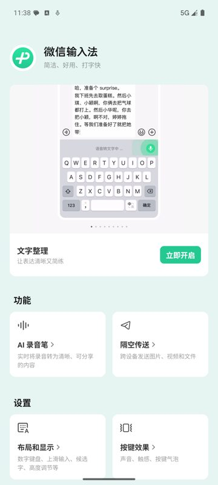](assets/images/android-20261018/33-carousel-01.png)

**首页轮播 02：AI 录音笔**

[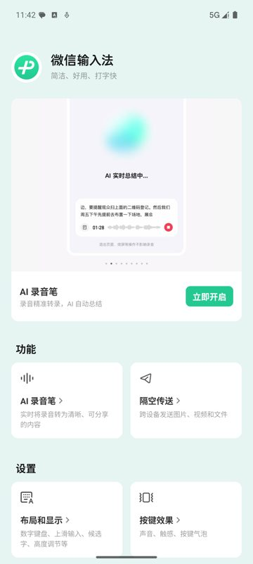](assets/images/android-20261018/34-carousel-02.png)

**首页轮播 03：多语言自由说大模型**

[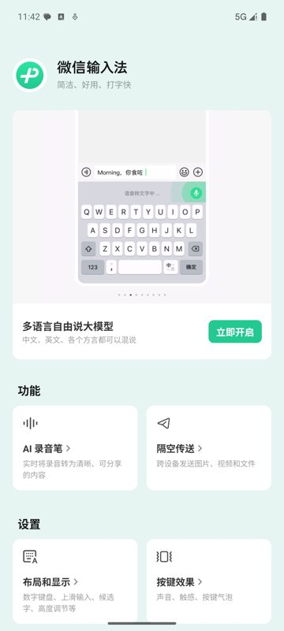](assets/images/android-20261018/35-carousel-03.png)

**首页轮播 04：表情推荐**

[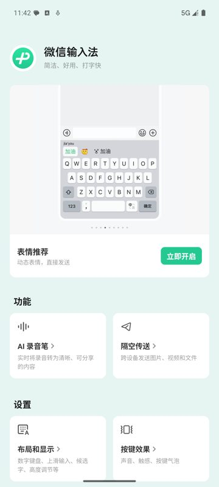](assets/images/android-20261018/36-carousel-04.png)

**首页轮播 05：趣味颜文字**

[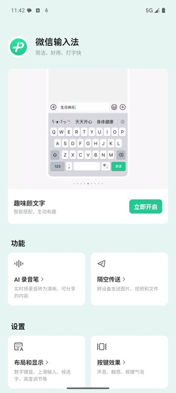](assets/images/android-20261018/37-carousel-05.png)

**首页轮播 06：问 AI**

[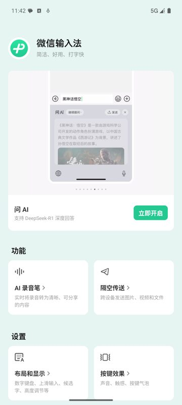](assets/images/android-20261018/38-carousel-06.png)

**首页轮播 07：排版成图**

[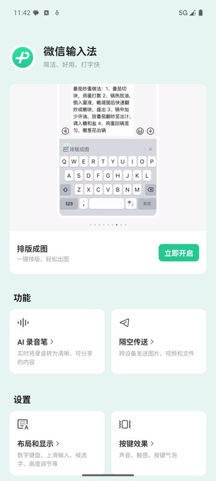](assets/images/android-20261018/39-carousel-07.png)

**首页轮播 08：跨设备粘贴传送**

[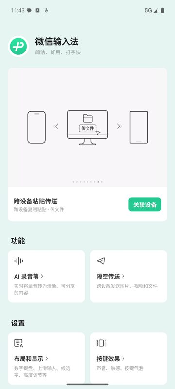](assets/images/android-20261018/40-carousel-08.png)

**首页轮播 09：灵动表达**

[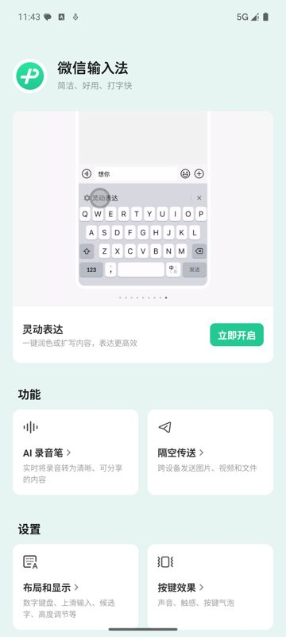](assets/images/android-20261018/41-carousel-09.png)

**灵动表达轮播 CTA**

[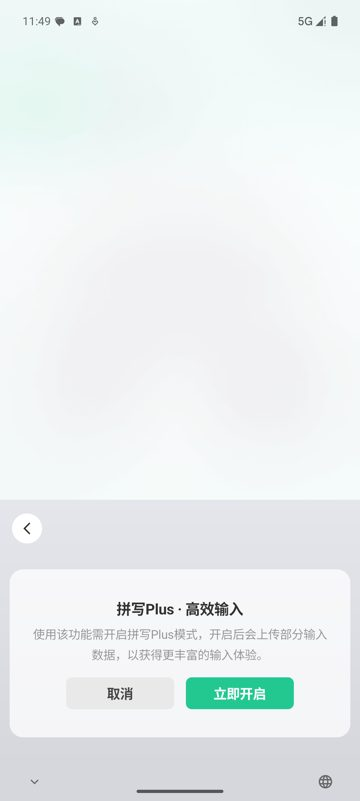](assets/images/android-20261018/42-expression-carousel-cta.png)


#### Android · 键盘与工具栏

**原版首页（独立截图）**

[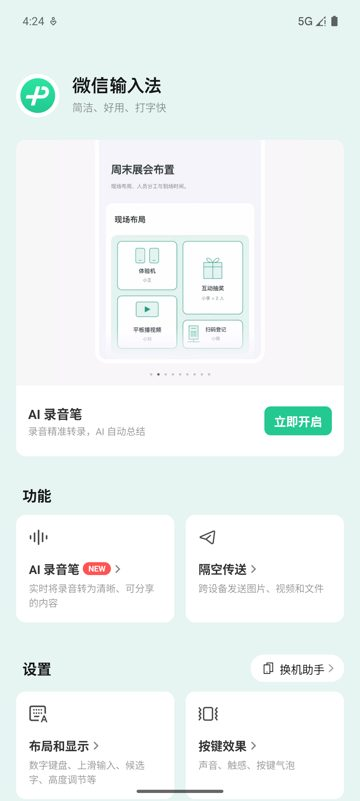](assets/images/android-keyboard/home_screen.png.png)

**候选栏与工具入口**

[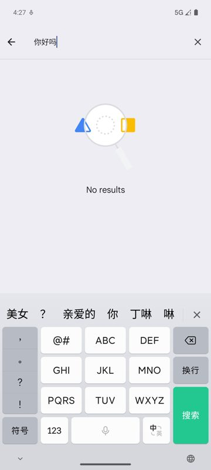](assets/images/android-keyboard/toolbar_screen.png.png)

**首次启动画面**

[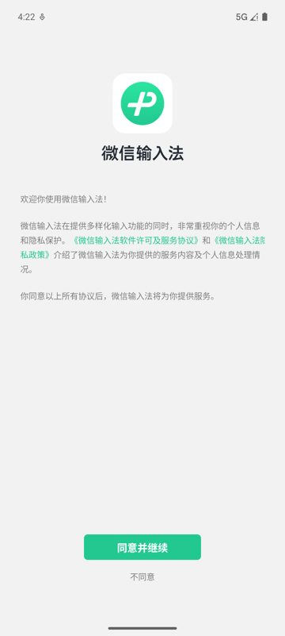](assets/images/android-keyboard/start_screen.png.png)

**候选上屏结果**

[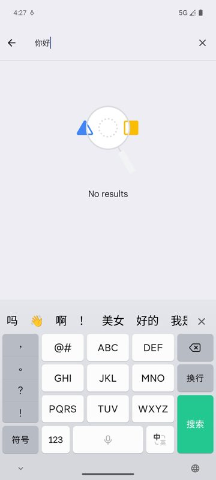](assets/images/android-keyboard/input-result_screen.png.png)

**九宫格拼音候选**

[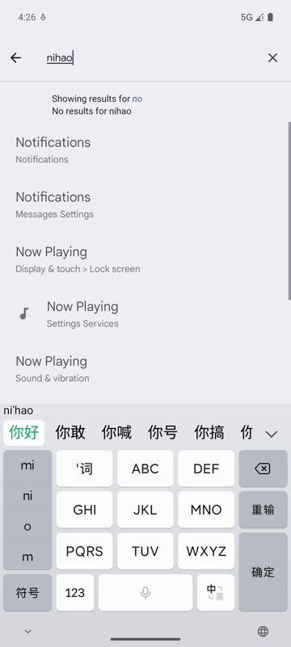](assets/images/android-keyboard/t9-candidates_screen.png.png)

**键盘选择：六种中文模式**

[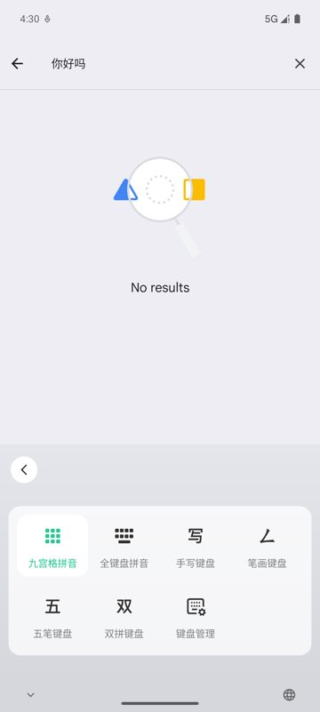](assets/images/android-keyboard/keyboard-modes_screen.png.png)

**键盘工具栏面板**

[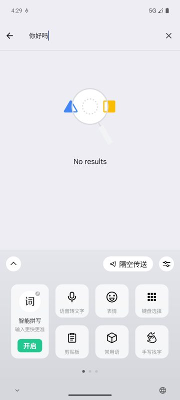](assets/images/android-keyboard/tools-panel_screen.png.png)


#### Android · 2026-10-20 复采

**首次隐私协议（2026-10-20 复采）**

[](assets/images/android-20261020/00-launch.png)

**隐私协议：同意并继续**

[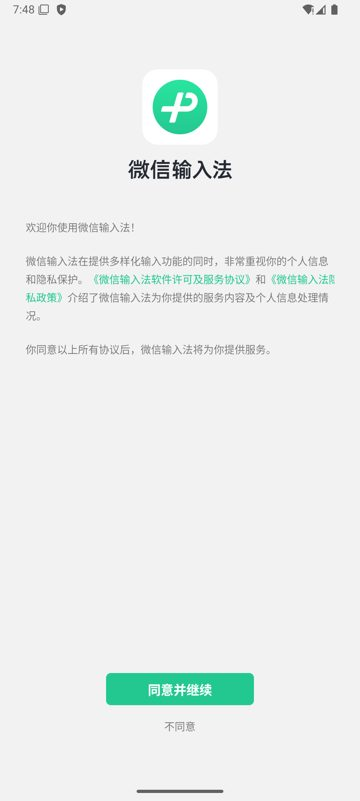](assets/images/android-20261020/10-privacy.png)

**首页顶部：轮播卡与功能入口（2026-10-20）**

[](assets/images/android-20261020/21-home-top.png)

**首页设置区（2026-10-20）**

[](assets/images/android-20261020/22-home-mid.png)

**首页底部：更多入口（2026-10-20）**

[](assets/images/android-20261020/23-home-bottom.png)

**从更多页面返回首页**

[](assets/images/android-20261020/24-home-bottom-return.png)

**布局和显示：顶部（2026-10-20）**

[](assets/images/android-20261020/30-layout-top.png)

**布局和显示：键盘高度与侧边栏**

[](assets/images/android-20261020/31-layout-mid.png)

**布局和显示：主题与拼音显示**

[](assets/images/android-20261020/32-layout-bottom.png)

**按键效果：声音/触感/气泡（2026-10-20）**

[](assets/images/android-20261020/33-key-effects.png)

**按键效果：下半**

[](assets/images/android-20261020/34-key-effects-bottom.png)

**定制工具栏：图标预览面板**

[](assets/images/android-20261020/35-custom-toolbar.png)

**辅助输入：上半（2026-10-20）**

[](assets/images/android-20261020/36-auxiliary-top.png)

**辅助输入：验证码、大写、双击空格**

[](assets/images/android-20261020/37-auxiliary-bottom.png)

**跨设备粘贴传送：关联设备、匹配码、传文件**

[](assets/images/android-20261020/38-device-sync.png)

**剪贴板设置：状态栏快速粘贴、历史记录**

[](assets/images/android-20261020/39-clipboard.png)

**键盘管理：六种中文键盘与键盘切换键**

[](assets/images/android-20261020/40-keyboard-manage.png)

**语音转文字设置（2026-10-20）**

[](assets/images/android-20261020/41-voice-top.png)

**语音转文字：离线语音、智能整理**

[](assets/images/android-20261020/42-voice-bottom.png)

**拼写 Plus 设置（2026-10-20）**

[](assets/images/android-20261020/43-plus-top.png)

**拼写 Plus：下半**

[](assets/images/android-20261020/44-plus-bottom.png)

**单机模式：离线说明与启用条件**

[](assets/images/android-20261020/45-standalone.png)

**换机助手**

[](assets/images/android-20261020/46-migration.png)

**隐私与权限（2026-10-20）**

[](assets/images/android-20261020/50-privacy.png)

**电脑版入口**

[](assets/images/android-20261020/51-desktop.png)

**关于微信输入法**

[](assets/images/android-20261020/52-about.png)

**帮助与反馈**

[](assets/images/android-20261020/53-feedback.png)

**AI 录音笔入口（2026-10-20）**

[](assets/images/android-20261020/60-recorder-entry.png)

**隔空传送：需开启拼写 Plus**

[](assets/images/android-20261020/61-file-transfer.png)

**首页轮播：问 AI**

[](assets/images/android-20261020/70-askai-card.png)

**问 AI 的拼写 Plus 门槛弹层**

[](assets/images/android-20261020/71-askai-open.png)

**开启拼写 Plus 后返回首页**

[](assets/images/android-20261020/72-askai-after-plus.png)

**微信输入法：候选栏稳定态**

[](assets/images/android-20261020/83-keyboard-t9-settled.png)

**深链 wetype://aiChat：回到首页轮播**

[](assets/images/android-20261020/deeplink-wetype___aiChat.png)

**深链 wetype://launchFileTransfer：隔空传送**

[](assets/images/android-20261020/deeplink-wetype___launchFileTransfer.png)

**深链 wetype://voiceRecorder：录音笔列表**

[](assets/images/android-20261020/deeplink-wetype___voiceRecorder.png)


#### iOS · 可见界面（非二进制）

**iOS 首页下半：设置项**

[](assets/images/ios-20261019/01-home-lower.jpg)

**iOS 首页顶部**

[](assets/images/ios-20261019/02-home-top.jpg)

**iOS 布局和显示**

[](assets/images/ios-20261019/03-layout-top.jpg)

**iOS 键盘高度与侧边栏**

[](assets/images/ios-20261019/04-layout-height-sidebar.jpg)

**iOS 首页顶部（静止态）**

[](assets/images/ios-20261019/05-home-top-rested.jpg)

**iOS 按键效果**

[](assets/images/ios-20261019/06-key-effects.jpg)

**iOS 键盘工具栏（模糊背景）**

[](assets/images/ios-20261019/07-toolbar-open-blurred.jpg)

**iOS 首页设置区**

[](assets/images/ios-20261019/08-home-settings-middle.jpg)

**iOS 语音设置**

[](assets/images/ios-20261019/09-voice-settings.jpg)

**iOS 语音入口（未跳转）**

[](assets/images/ios-20261019/10-voice-no-jump.jpg)

**iOS 单机模式**

[](assets/images/ios-20261019/11-standalone.jpg)

**iOS 拼写 Plus**

[](assets/images/ios-20261019/12-spelling-plus.jpg)

**iOS 拼写 Plus 下半**

[](assets/images/ios-20261019/13-spelling-plus-bottom.jpg)

**iOS 首页更多**

[](assets/images/ios-20261019/14-home-more.jpg)

**iOS 关于与版本**

[](assets/images/ios-20261019/15-about-version.jpg)

**iOS 键盘管理**

[](assets/images/ios-20261019/16-keyboard-management.jpg)

**iOS 辅助输入顶部**

[](assets/images/ios-20261019/17-auxiliary-input-top.jpg)

**iOS 辅助输入中部**

[](assets/images/ios-20261019/18-auxiliary-input-middle.jpg)

**iOS 辅助输入纠错项**

[](assets/images/ios-20261019/19-auxiliary-input-correction.jpg)

**iOS 辅助输入底部**

[](assets/images/ios-20261019/20-auxiliary-input-bottom.jpg)


## 4. 键盘系统

### 4.1 布局清单（36 套）

| 家族 | 文件 | T9 | 行 | 键 | 基准宽 | 基准高 |
|---|---|---|---|---|---|---|
| Emoji | S11EmojiKeyboard.json | False | 4 | 6 | 1080 | 788 |
| 中文拼音 | S1ChineseT9Keyboard.json | True | 4 | 18 | 1080 | 628 |
| 中文拼音 | S1ChineseT9KeyboardLand.json | True | 4 | 18 | 1080 | 628 |
| 中文拼音 | S27HandwriteFindWordT9Keyboard.json | True | 4 | 18 | 1080 | 628 |
| 中文拼音 | S27HandwriteFindWordT9KeyboardLand.json | True | 4 | 18 | 1080 | 628 |
| 中文拼音 | S28HandwriteFindWordT26Keyboard.json | False | 4 | 34 | 1080 | 628 |
| 中文拼音 | S28HandwriteFindWordT26KeyboardLand.json | False | 4 | 38 | 1080 | 628 |
| 中文拼音 | S2ChineseQwertyKeyboard.json | False | 4 | 34 | 1080 | 628 |
| 中文拼音 | S2ChineseQwertyKeyboardLand.json | False | 4 | 38 | 1080 | 628 |
| 中文拼音 | S2ChineseQwertyKeyboardLargeSplit.json | False | 4 | 34 | 1080 | 628 |
| 中文拼音 | S2ChineseQwertyKeyboardSplit.json | False | 4 | 38 | 1080 | 628 |
| 五笔 | S17WuBiQwertyKeyboard.json | False | 4 | 34 | 1080 | 628 |
| 五笔 | S17WuBiQwertyKeyboardLand.json | False | 4 | 38 | 1080 | 628 |
| 双拼 | S8DoublePinT9Keyboard.json | True | 4 | 18 | 1080 | 628 |
| 双拼 | S8DoublePinT9KeyboardLand.json | True | 4 | 18 | 1080 | 628 |
| 双拼 | S9DoublePinQwertyKeyboard.json | False | 4 | 34 | 1080 | 628 |
| 双拼 | S9DoublePinQwertyKeyboardLand.json | False | 4 | 38 | 1080 | 628 |
| 手写 | HandWriteFullscreenKeyboard.json | False | 4 | 10 | 1080 | 300 |
| 手写 | HandWriteKeyboard.json | False | 4 | 10 | 1080 | 885 |
| 数字/符号 | S12EnglishNumberSymbolKeyboard.json | False | 4 | 34 | 1080 | 628 |
| 数字/符号 | S12EnglishNumberSymbolKeyboardLand.json | False | 4 | 35 | 1080 | 628 |
| 数字/符号 | S13ChineseNumberSymbolKeyboard.json | False | 4 | 34 | 1080 | 628 |
| 数字/符号 | S13ChineseNumberSymbolKeyboardLand.json | False | 4 | 35 | 1080 | 628 |
| 数字/符号 | S13ChineseNumberSymbolKeyboardSplit.json | False | 4 | 36 | 1080 | 628 |
| 数字/符号 | S26PureNumberKeyboard.json | None | 4 | 14 | 1080 | 628 |
| 数字/符号 | S4NumberKeyboard.json | True | 4 | 18 | 1080 | 628 |
| 数字/符号 | S4NumberKeyboardLand.json | True | 4 | 18 | 1080 | 628 |
| 数字/符号 | S5SymbolKeyboard.json | False | 4 | 11 | 1080 | 628 |
| 数字/符号 | S5SymbolKeyboardLand.json | False | 4 | 21 | 1080 | 628 |
| 数字/符号 | S5SymbolKeyboardView.json | False | 3 | 28 | 1080 | 628 |
| 数字/符号 | S5SymbolKeyboardViewLand.json | False | 3 | 31 | 1080 | 628 |
| 笔画 | S7StrokeT9Keyboard.json | True | 4 | 18 | 1080 | 628 |
| 笔画 | S7StrokeT9KeyboardLand.json | True | 4 | 18 | 1080 | 628 |
| 英文 | S3EnglishQwertyKeyboard.json | False | 4 | 35 | 1080 | 628 |
| 英文 | S3EnglishQwertyKeyboardLand.json | False | 4 | 39 | 1080 | 628 |
| 表情包 | S22StickerKeyboard.json | False | 4 | 1 | 1080 | 628 |

布局 JSON 的结构是：`config`（名称枚举、参考宽高、行数、行高、行距、是否 T9、对齐、边距）+ `keyDefaultConfig`（默认文本/颜色/圆角/阴影/功能码）+ `keys`（按行分组的按键覆盖）。每个键的 `mainText`、`floatText`、`width`、`height`、`bgCorner`、`clickFunctionCode` 都是三元素数组，分别对应竖屏/横屏/平板三种参考形态。复刻版按同一几何模型重建，不直接复制腾讯的样式资源。

### 4.2 键盘预览

<div class="keyboard-grid">
<figure><figcaption>九宫格拼音（S1）</figcaption></figure>
<figure><figcaption>全键盘拼音（S2）</figcaption></figure>
<figure><figcaption>笔画（S7）</figcaption></figure>
<figure><figcaption>五笔（S17）</figcaption></figure>
<figure><figcaption>双拼全键盘（S9）</figcaption></figure>
<figure><figcaption>符号面板（S5）</figcaption></figure>
<figure><figcaption>Emoji（S11）</figcaption></figure>
<figure><figcaption>手写（HandWrite）</figcaption></figure>
</div>

### 4.3 输入状态机


复刻引擎的关键不变量：

- **组合缓冲区与宿主 composing 文本分离**：拼音/笔画/五笔编码先进入内部 buffer，候选确认后才 `commitText`；删除键先退 buffer，再退宿主文本。
- **候选排序**：精确前缀 > 模糊拼音匹配 > 词频/用户学习 > 长度惩罚；固定词优先；删除词写入本地黑名单。
- **六种模式共享同一宿主连接**：切换模式不重建输入连接；`chSwitch` 只切语言/模式，不提交未完成编码。
- **语音入口**：长按空格或语音键进入 listening；partial 结果只更新候选区/预览，release 后按“松手发送/编辑/撤回”策略提交；取消必须恢复进入前的文本范围。
- **工具栏**：工具面板是键盘的一部分，不是独立 Activity；问 AI/整理/翻译需要把当前选中文本与来源通过消息/深链交给独立页面，返回时只替换明确范围。

### 4.4 可复刻与不可复刻

| 部分 | 可复刻 | 不可复刻/需替代 |
|---|---|---|
| 布局与几何 | 36 套 JSON 的键位、行列、宽高、行高、T9 标记 | 腾讯的字体、图标、皮肤资源 |
| 候选 | 拼音切分、T9 映射、模糊拼音、词频/学习、固定/删除 | 腾讯私有语言模型与云端排序 |
| 五笔/笔画/双拼 | 公开编码表与方案映射 | 腾讯私有词库与联想权重 |
| 手写 | 轨迹采集、方向量化、模板匹配、候选展示 | 腾讯自然连笔识别模型 |
| 语音 | 系统 ASR/自有 ASR、partial/final、标点、取消/重试 | 腾讯云语音模型与私有双链路 |
| AI | 自有后端 + DeepSeek、提示词、流式/取消/历史 | 腾讯 AI Chat WebView 的私有协议 |

## 5. 设置与数据模型

### 5.1 主设置字段（37）

`MainSettingInfo` 是 RN 设置页与原生键盘共享的主模型。以下字段来自 REA 类清单（Evidence `ev_e2563ea1bfce66af4`），类型为 JADX 报告的声明类型。

| 字段 | 类型 | 语义（工作译名） |
|---|---|---|
| candidateWordSize | int | 候选字大小 |
| colorThemeInfo | ColorThemeInfo | 主题子模型 |
| fuzzyPinyinInfo | FuzzyPinyinInfo | 模糊拼音子模型 |
| isClipboardEnableState | boolean | 剪贴板读取开关 |
| isDefaultEnterActionSend | boolean | 回车键发送 |
| isEmojiQuickSettingMode | boolean | 表情快捷键模式 |
| isEnableAssociating | boolean | 联想 |
| isEnableAutoSpace123Mode | boolean | 中文/数字自动空格 |
| isEnableAutoSpaceAbcMode | boolean | 中文/英文自动空格 |
| isEnableDirectPreInput | boolean | 拼音直接预输入 |
| isEnableDoubleTapSpaceMode | boolean | 双击空格句号 |
| isEnableEnglishAutoCorrect | boolean | 英文纠错 |
| isEnableFirstUpperCaseMode | boolean | 首字母大写 |
| isEnableFuzzyPinyin | boolean | 模糊拼音总开关 |
| isEnableHandwriteFindWord | boolean | 手写找字 |
| isEnableHideKeyboardButton | boolean | 隐藏键盘键 |
| isEnableKeyButtonFloatPreviewMode | boolean | 按键气泡 |
| isEnableParticipleForT26Mode | boolean | 26 键分词 |
| isEnablePlusMode | boolean | 拼写 Plus 总开关 |
| isEnableSMSVerificationCodeAuto | boolean | 短信验证码建议 |
| isEnableStandaloneMode | boolean | 单机模式 |
| isEnableStatusBarPasteBoard | boolean | 通知栏剪贴板 |
| isEnableT26ToT9NumberMode | boolean | 26 键九宫格数字 |
| isEnableVoiceInputButton | boolean | 语音按钮 |
| isEnableVoiceRecorder | boolean | AI 录音笔 |
| isEnableVoiceRecorderRecapSync | boolean | 录音纪要同步 |
| isSupportAskAI | boolean | 问 AI 能力标记 |
| isVoiceRecorderRecording | boolean | 录音中 |
| isVoiceRecorderUsed | boolean | 录音笔已使用 |
| keystrokeEffectInfo | KeystrokeEffectInfo | 按键效果子模型 |
| needUpdateStandaloneMode | boolean | 单机模式需更新 |
| plusItemInfo | PlusItemInfo | Plus 子开关 |
| redPointStandaloneMode | boolean | 单机模式红点 |
| swipeUpInputMode | int | 上滑输入模式 |
| unreadInfo | UnreadInfo | 未读/红点 |
| voiceInputInfo | VoiceInputInfo | 语音子模型 |

### 5.2 子模型

| 模型 | 字段数 | 关键字段 |
|---|---|---|
| `PlusItemInfo` | 10 | isEnableAskAI / isEnableSmartSpelling / isEnableSpellingCorrect / isEnableStickerRecommend / isEnableSmallEmoji / isEnableKaomoji / isEnableRewriteRecommend / isEnableTextPolish / isEnableTextPoster / isEnableQuickSend |
| `VoiceInputInfo` | 11 | isEnableOfflineSpeech / isEnableVoiceInputLongClickTrigger / isEnableVoiceInputReleaseToSend / isEnableVoiceInputSmartTextPolish / voiceIconShowTimeIndex / voiceInputPunctuationIndex / voiceInputLanguageType / voiceInputDialectInfo |
| `KeystrokeEffectInfo` | 5 | isEnableKeySound / keySoundVolumeSize / isEnableKeyVibrate / keyVibrateLevel / isEnableVibrateFollowSystem |
| `DisplaySettingInfo` | 1 | candidateWordGear |
| `FuzzyPinyinInfo` | 19 | 20 组模糊音：zzh/cch/ssh、nl/rl、anang/eneng/ining/… |
| `ColorThemeInfo` | 1 | colorThemeMode：跟随系统/浅色/深色 |


### 5.3 设置页与写入关系

| 页面 | 主要字段/行为 | 证据 |
|---|---|---|
| 布局和显示 | T9NumberKeyboard、SlideInput、Emoji、键盘高度、侧边栏、ColorThemeMode、DirectPreInput、候选字大小 | `30`–`32` 运行截图；`DisplaySettingInfo` |
| 按键效果 | KeystrokeSound、KeystrokeVibrate、KeyBubble；声音/触感分档 | `33`–`34`；`KeystrokeEffectInfo` |
| 辅助输入 | DefaultEnterActionSend、AutoSpace123、AutoSpaceAbc、SMSVerificationCodeAuto、KeyboardCapitalize、KeyboardDoubleSpaceFullstop、模糊拼音 | `36`–`37`；`MainSettingInfo` |
| 语音转文字 | 标点、长按空格、松手发送、智能整理、离线语音、识别语言、语音图标 | `41`–`42`；`VoiceInputInfo` |
| 拼写 Plus | 总开关 + 10 个子开关；表情/Emoji/颜文字/拼写检查/灵动表达/问 AI/文字整理/排版成图 | `43`–`44`；`PlusItemInfo` |
| 剪贴板 | StatusBarPasteBoard、Clipboard 历史记录 | `39` |
| 跨设备 | 跨设备复制粘贴、词库同步、常用语同步、录音纪要同步、传文件 | `38` |
| 隐私与权限 | 输入法启用状态、个人词典清除、麦克风/相机等权限 | `50` |

### 5.4 持久化与共享

原版同时存在 Kotlin 序列化模型、MMKV（`libmmkv.so`）和 RN storage；主进程与 `:hld` 进程通过 IPC/服务共享设置。复刻版不复制其存储实现，改用：

- 客户端：`SharedPreferences`（Android）/ `UserDefaults` + App Group（iOS）/ `shared_preferences`（Flutter）；
- 结构化模型：JSON schema + 版本迁移；
- 敏感数据：剪贴板历史默认不落盘，语音原文不持久化；API key 只在服务端。

## 6. AI、语音、翻译与后端

### 6.1 功能分层

| 能力 | 原版入口 | 原版实现线索 | 复刻实现 |
|---|---|---|---|
| 问 AI | 键盘工具栏/首页问 AI | `AiChatActivity` 内 `mAiChatWebView`；`Ab.g.e` 启动；`initialProperties` Bundle | 自有 AI 聊天页 + SSE |
| 文字整理 | 键盘工具栏/拼写 Plus | 文字工具链、回填/撤回 | 后端 `/v1/ai/polish` + 原文快照/撤回 |
| 灵动表达 | 拼写 Plus | 改写/润色候选 | 后端 `/v1/ai/rewrite`，候选预览/应用 |
| 边写边译 | 键盘工具栏 | 源区/宿主双区、语言列表 | 本地双区 + 后端 `/v1/ai/translate` |
| 语音转文字 | 长按空格/语音键 | AudioRecord 16k mono PCM16；在线/离线链 | 系统 ASR；可选后端 ASR |
| AI 录音笔 | 首页功能卡 | VoiceRecorderActivity + 实时转写 + AI 总结 | 录音 + ASR + `/v1/ai/summary` |
| 表情/颜文字/Emoji | 拼写 Plus/键盘 | 表情推荐、Emoji/贴纸布局 | 本地资源 + 关键词映射 |
| 排版成图 | 拼写 Plus | 文字海报/模板 | Canvas 渲染 + 保存/分享 |
| 跨设备/传送 | 首页/键盘 | RequestSync / RequestMigration / weread 落地页 | 自有后端配对/中转 |

### 6.2 协议入口（静态可见）

`setup.js` 中有完整的 protobuf 模块名与字段校验字符串，但没有公开的 base URL：

| 协议族 | 消息 | 用途 |
|---|---|---|
| `RequestChat` | ChatClientInfo / ChatItem / ChatMessageContent / ChatListReq·Rsp / InnerChatListReq·Rsp / ReplyReq·Rsp / SendChatReq·Rsp / SyncChatReq·Rsp | AI 聊天、历史、发送、回复、同步 |
| `RequestDispatch` | FeedbackPushItem / BundleItem / … | 反馈/资源分发 |
| `RequestSync` | BindMatchCodeReq·Rsp / ClipboardMsg / DeviceInfo / … | 设备配对、剪贴板、词库同步 |
| `RequestMigration` | GenerateMigrationQrCode / Occupy / Release / GetMigrationInfo / Finish / Cancel / DataUploaded / DataDownloaded | 换机助手二维码与迁移状态 |

已知域名（仅证明客户端会访问，不证明可复用）：

| 域名/路径 | 用途 | 可复刻性 |
|---|---|---|
| `wetype.wxqcloud.qq.com/page/article/...` | 帮助/文章 | 不可复用；自有帮助页 |
| `download.z.weixin.qq.com/page/article/...` | 文章/更新说明 | 不可复用 |
| `wxkeyboardcms-1258476243.file.myqcloud.com/page/help_detail/...` | 帮助详情 CDN | 不可复用 |
| `weread.qq.com/wetype/devicetransfer?deviceid=...` | 文件传送落地/配对 | 不可复用；自有后端 |
| `weread.qq.com/sentry/20` | Sentry DSN（崩溃上报） | 不复用；自有日志 |
| `http://localhost:8081/` | Metro 开发服务器（调试） | 仅开发 |

**为什么官方后端不可获得**：

1. 客户端没有暴露通用 REST base URL；AI Chat 是 WebView 页面，登录/会话/签名由腾讯域完成。
2. 同步/迁移/传送使用 protobuf + 设备/账号上下文；`libime_net.so` 内还有签名、重试、加密与证书固定。
3. 即使抓到请求，也缺少服务端模型、提示词、配额与合规授权；直接复用会违反服务条款并带来隐私风险。
4. 因此本项目的客户端从第一天就把 `API_BASE_URL` 作为可配置项，不依赖任何腾讯域名。

### 6.3 替代后端 API（本项目）

| 方法/路径 | 请求 | 响应 | 用途 |
|---|---|---|---|
| `POST /v1/ai/chat` | `{messages, model?, stream?}` | SSE 或 `{text}` | 问 AI / 多轮 |
| `POST /v1/ai/polish` | `{text, mode}` | `{text}` | 文字整理 |
| `POST /v1/ai/rewrite` | `{text, style, count}` | `{candidates[]}` | 灵动表达 |
| `POST /v1/ai/translate` | `{text, source, target}` | `{text}` | 边写边译 |
| `POST /v1/ai/summary` | `{transcript, title?}` | `{summary, bullets[]}` | 录音纪要 |
| `POST /v1/asr` | multipart audio | `{text, segments[]}` | 语音转写 |
| `POST /v1/sync/pair` | `{code, device}` | `{token, peer}` | 设备配对 |
| `POST /v1/sync/clipboard` | `{token, items[]}` | `{items[]}` | 剪贴板同步 |
| `POST /v1/sync/phrases` | `{token, phrases[]}` | `{phrases[]}` | 常用语同步 |
| `POST /v1/transfer/upload` | multipart file | `{id, sha256, size}` | 文件传送 |
| `GET /v1/transfer/{id}` | — | bytes | 下载 |
| `GET /health` | — | `{ok, model}` | 健康检查 |

### 6.4 AI 数据流


**密钥策略（强制）**：

- 服务端从环境变量 `DEEPSEEK_API_KEY` 读取；本地开发可从 `/Users/lwblx/Documents/ds_api` 注入，但**不写入仓库、不写入客户端、不打印完整 key**。
- 公开仓库只提供 `.env.example`；`.gitignore` 排除 `.env`、`*.key`、`local.properties`。
- 客户端只持有短期 app token（可选的本地配对 token），不持有模型 key。
- 日志只记录 key 的前缀与 SHA-256 短指纹（与 `AGENTS.md` 一致）。

**本仓库已实测**（`evidence/backend/smoke.json`）：`/v1/ai/chat` 返回 200 与中文回答；`/v1/ai/polish` 返回整理后的文本；配对、剪贴板、常用语、文件上传/下载均通过，下载 SHA-256 与上传一致。测试使用个人 DeepSeek 官网 key（前缀 `sk-3b…`，SHA-256 短指纹 `7854e990e85e`），完整 key 未写入仓库或日志。

### 6.5 语音/翻译状态机

- 语音：`permission → start → partial* → stop → final → punctuation → optional polish → commit`；取消时恢复进入前的 composing 范围。
- 翻译：源区 `TextWatcher` → 600 ms 防抖 → 串行请求 → 仅接受最新序号 → 宿主替换本轮范围；发送后清空本轮但保持模式。
- 所有 AI 请求支持 `cancel`、超时、重试和错误码；UI 不伪造成功结果。


## 7. iOS 分析状态

### 7.1 能做与不能做

| 项目 | 结果 | 说明 |
|---|---|---|
| iOS 原版 IPA | 未取得 | App Store 下载需要 Apple ID/购买上下文；本机没有 IPA 缓存 |
| 已配对 iPhone 安装 | 未发现 | `devicectl` 查询 bundle 中没有微信输入法 |
| 越狱/解密设备 | 无 | 无法从设备导出解密 Mach-O |
| iOS 二进制静态分析 | 不可做 | 没有 IPA/Mach-O，不能用 Android 结论冒充 |
| iOS 可见界面 | 20 张 | iPhone Mirroring，版本 3.5.5；仅可见 UI/文案 |

### 7.2 iOS 可见界面

**iOS 首页下半：设置项**

[](assets/images/ios-20261019/01-home-lower.jpg)

**iOS 首页顶部**

[](assets/images/ios-20261019/02-home-top.jpg)

**iOS 布局和显示**

[](assets/images/ios-20261019/03-layout-top.jpg)

**iOS 键盘高度与侧边栏**

[](assets/images/ios-20261019/04-layout-height-sidebar.jpg)

**iOS 首页顶部（静止态）**

[](assets/images/ios-20261019/05-home-top-rested.jpg)

**iOS 按键效果**

[](assets/images/ios-20261019/06-key-effects.jpg)

**iOS 键盘工具栏（模糊背景）**

[](assets/images/ios-20261019/07-toolbar-open-blurred.jpg)

**iOS 首页设置区**

[](assets/images/ios-20261019/08-home-settings-middle.jpg)

**iOS 语音设置**

[](assets/images/ios-20261019/09-voice-settings.jpg)

**iOS 语音入口（未跳转）**

[](assets/images/ios-20261019/10-voice-no-jump.jpg)

**iOS 单机模式**

[](assets/images/ios-20261019/11-standalone.jpg)

**iOS 拼写 Plus**

[](assets/images/ios-20261019/12-spelling-plus.jpg)

**iOS 拼写 Plus 下半**

[](assets/images/ios-20261019/13-spelling-plus-bottom.jpg)

**iOS 首页更多**

[](assets/images/ios-20261019/14-home-more.jpg)

**iOS 关于与版本**

[](assets/images/ios-20261019/15-about-version.jpg)

**iOS 键盘管理**

[](assets/images/ios-20261019/16-keyboard-management.jpg)

**iOS 辅助输入顶部**

[](assets/images/ios-20261019/17-auxiliary-input-top.jpg)

**iOS 辅助输入中部**

[](assets/images/ios-20261019/18-auxiliary-input-middle.jpg)

**iOS 辅助输入纠错项**

[](assets/images/ios-20261019/19-auxiliary-input-correction.jpg)

**iOS 辅助输入底部**

[](assets/images/ios-20261019/20-auxiliary-input-bottom.jpg)


这些图片的源文件实际是 JPEG（664×1448），历史索引曾把后缀写成 `.png` 并记录错误尺寸；本报告按修正后的元数据展示，未修改原始字节。iPhone Mirroring 的 AX 文本不是原版控件树，不能据此推断内部实现。

### 7.3 iOS 复刻策略

- **原生 SwiftUI 主应用** + **Keyboard Extension**；键盘扩展使用同一套布局规格与候选引擎的 Swift 实现。
- **Full Access**：键盘扩展需要 `RequestsOpenAccess` 才能在扩展内访问网络/共享容器；未开启时明确降级为本地输入。
- **Share Extension**：从照片/文件分享进入“隔空传送”。
- **iPad**：`NavigationSplitView` / 自适应网格；键盘扩展使用 iPad 布局（更大键距、左右分栏、悬浮键盘）。
- **不声称二进制同构**：iOS 的页面结构来自可见界面 + Android 已验证行为；差异在报告中逐项标注。

## 8. 复刻蓝图

### 8.1 三套交付物


| 交付物 | 技术 | 目标 | 系统键盘 | 平板 |
|---|---|---|---|---|
| `clone-flutter/` | Flutter 3.47 / Dart 3.13 | Android + iOS 通用应用 | 应用内键盘 + 原生扩展壳 | 自适应网格 |
| `clone-android/` | Kotlin / Jetpack Compose + InputMethodService | Android 原生 | 真实 IME | 平板布局 |
| `clone-ios/` | SwiftUI + UIKit keyboard extension | iOS 原生 | Keyboard Extension | iPad 布局 |
| `backend/` | Python FastAPI（或 Node） | AI/ASR/同步/传送 | — | — |
| `shared/` | JSON/Dart/Kotlin/Swift 资源 | 布局、词库、设计 token | — | — |

### 8.2 共享规格

- `shared/spec/keyboard_layouts.json`：从 36 套原版布局归一化的键位/几何/标签（只保留事实结构，重建视觉）。
- `shared/spec/design_tokens.json`：`#E6F4F2` 背景、`#FFFFFF` 卡片、`#24C891` 强调、`#333333` 主文字、`#B8BCC5` 次文字、16–20 px 圆角。
- `shared/data/pinyin.json`、`wubi.json`、`stroke.json`、`phrases.json`、`emoji.json`。
- `shared/contracts/openapi.yaml`：后端 API。

### 8.3 复刻范围矩阵

| ID | 范围 | 原版证据 | 复刻目标 |
|---|---|---|---|
| F01 | 系统键盘接入/启用引导 | WxHldService、HldActivationUI、IME 权限流程 | Android 已验证；iOS 需键盘扩展 |
| F02 | 六种中文键盘 | 36 套 layout JSON；键盘管理分组 | T9/QWERTY/手写/笔画/五笔/双拼 |
| F03 | 全键盘拼音、九宫格、中英切换 | S1/S2/S3 布局、候选栏、chSwitch | 本地拼音引擎 + 词库 |
| F04 | 五笔/笔画/双拼 | S17/S7/S8/S9 布局；方案字符串 | 编码表 + 候选引擎 |
| F05 | 手写与手写找字 | HandWrite 布局、手写找字键盘 | 笔画轨迹模板 + 找字 |
| F06 | 候选排序、固定、删除 | 候选引擎类、用户词频 | 频率/学习/固定词 |
| F07 | 智能拼写与纠错 | 拼写 Plus、拼写检查 | 后端/本地纠错 |
| F08 | 光标编辑、删除、撤回 | 宿主 InputConnection、删除键 | 宿主文本操作 |
| F09 | 个性化与工具栏 | 定制工具栏、Plus、皮肤 | 图标排序/开关 |
| F10 | 数字、符号、计算器 | S4/S5/S12/S13/S26 布局 | 表达式求值 |
| F11 | 常用语与自定义输入码 | 常用语资源、剪贴板/短语 | 本地持久化 |
| F12 | 剪贴板与选词粘贴 | SetupClipboard、状态栏粘贴 | 剪贴板历史 |
| F13 | 语音完整生命周期 | VoiceRecorder、ASR 链 | 系统 ASR + 后端总结 |
| F14 | 中英混说/方言 | 语音语言设置 | 后端/系统识别 |
| F15 | 长语音与离线语音 | 离线语音设置、模型下载 | 本地模型/降级 |
| F16 | 语音启动体验/音频路由 | 长按空格、松手发送、录音待机 | 平台权限/生命周期 |
| F17 | 文字整理 | 文字整理、AI 回填链 | 后端 polish |
| F18 | 问 AI 与多轮回答 | AiChatActivity WebView、RequestChat | 自有 AI 聊天 |
| F19 | 灵动表达/文案润色 | SetupPlus、灵动表达 | 后端 rewrite |
| F20 | 边写边译 | 翻译链、语言列表 | 后端 translate |
| F21 | 表情推荐与定制 | 表情推荐、Emoji/贴纸布局 | 本地表情库 |
| F22 | 颜文字/字体滤镜 | 颜文字、字体滤镜 | 本地模板 |
| F23 | 排版成图 | 排版成图、文字海报 | Canvas 渲染 |
| F24 | 书影音/小程序分享 | 智能推荐、小程序 | 自有内容/分享 |
| F25 | 跨设备剪贴板/词库/常用语同步 | GeneralDeviceSync、RequestSync | 后端同步 |
| F26 | 隔空传送 | ImeFileTransferUI、weread 落地页 | 后端中转/LAN |
| F27 | 换机助手 | SetupMigrationAssistant、RequestMigration | 后端迁移 |
| F28 | iOS 分享扩展/快捷入口 | iOS 端可见页面 | Swift Share Extension |
| F29 | 短信验证码/外接键盘 | SMS 权限、硬件键盘 | Android 平台能力 |
| F30 | 单机/联网与数据控制 | HldStandaloneModeUI、隐私页 | 本地模式 + 清除 |

### 8.4 算法实现要点

1. **拼音/T9**：声母韵母切分；数字串→候选音节组合；候选评分 `prefix + fuzzy + freq + user`；支持简拼、全拼、混输；固定词/删除词持久化。
2. **五笔**：86/98/新世纪三套码表（先内置常用字，后续可扩展到全表）；四码唯一上屏、第五码首选、编码提示、五笔拼音混输。
3. **笔画**：五种基本笔画 + 通配；按笔顺匹配候选；手写与笔画共享候选面板。
4. **双拼**：小鹤/自然码/微软/搜狗/智能 ABC/紫光/拼音加加；声母韵母映射表；全键盘与九宫格两种形态。
5. **手写**：8 方向量化 + 重采样 + 模板距离；先支持常用字/演示字集，UI 明确标注识别范围；全屏手写与手写找字复用同一画布。
6. **语音**：`speech_to_text`（Flutter）/ `SpeechRecognizer`（Android）/ `SFSpeechRecognizer`（iOS）；partial/final、标点、超时、取消、权限拒绝；录音笔另存音频并调用后端总结。
7. **AI**：系统提示词固定“简洁、直接、不改事实”；流式输出；取消/重试；历史只存本地；不自动发送未确认文本。
8. **同步/传送**：6 位配对码 → token；剪贴板/常用语/设置增量同步；文件分片上传/下载 + SHA-256 校验；失败可重试。

### 8.5 设计还原

| Token | 值 | 用途 |
|---|---|---|
| 背景 | `#E6F4F2` | 首页/设置页浅绿背景 |
| 卡片 | `#FFFFFF` | 功能卡、设置卡 |
| 强调 | `#24C891` | 主按钮、选中态、开关 |
| 主文字 | `#333333` | 标题/正文 |
| 次文字 | `#B8BCC5` | 说明/占位 |
| 分隔/描边 | `#DCE7E3` | 卡片描边、键盘键描边 |
| 圆角 | 16–24 px | 卡片/键盘键/弹层 |
| 字体 | PingFang SC / Noto Sans CJK | 中文；英文用系统 sans |
| 网格 | 手机 2 列；平板 4 列 | 首页功能/设置卡 |

### 8.6 验收方式

- 每个平台至少：首次启用 → 首页 → 六种键盘 → 候选上屏 → 工具栏 → 语音 → AI → 剪贴板/常用语 → 单机/隐私 → 平板布局。
- 运行截图存 `evidence/clone-*`；HTML 报告增加“复刻实测”分组。
- 不以单元测试替代宿主内实际输入；不以静态 UI 替代跳转。

## 9. 证据附录

### 9.1 REA Evidence

| 操作 | Selector | Evidence ID | 文件 |
|---|---|---|---|
| inspect_android_class | com.tencent.wetype.plugin.hld.reactnative.activity.ImeMainSettingActivity | `ev_5a67fe78211c24c4e36a066836f0555ef85c77d3c27342510bda09b9b4fb8faa` | `class-com.tencent.wetype.plugin.hld.reactnative.activity.ImeMainSettingActivity.json` |
| inspect_android_class | com.tencent.wetype.plugin.hld.ui.HldActivationUI | `ev_1c72907e35cf515fcc9cb1cdff482d745e82c2dcd354aeaad472d003950cff2b` | `class-com.tencent.wetype.plugin.hld.ui.HldActivationUI.json` |
| inspect_android_class | com.tencent.wetype.plugin.hld.ui.HldPrivacyInfoUI | `ev_3e5210cc4c78cdfd9a1dedcd68c5867404bad18df2fee4da6cea0e973af5d839` | `class-com.tencent.wetype.plugin.hld.ui.HldPrivacyInfoUI.json` |
| inspect_android_method | com.tencent.wetype.plugin.hld.reactnative.activity.ImeMainSettingActivity.Q1 | `ev_667e14bfc7f2688abe99b5a7bf30623280fb92b41c2ce9cb2c20ae8adf703ea4` | `main-Q1.json` |
| inspect_android_method | com.tencent.wetype.plugin.hld.reactnative.activity.ImeMainSettingActivity.R1 | `ev_2fb38fa49b8a4266ec611086df2246ce747afcb055ad63140c68b3a8a5b20e26` | `main-R1.json` |
| inspect_android_class | com.tencent.wetype.plugin.hld.reactnative.activity.ImeMainSettingActivity | `ev_41c9cedc2909dd7dd417ad7fb15117c59b8abc502653ef2380b05a430295dff6` | `main-class.json` |
| inspect_android_method | com.tencent.wetype.plugin.hld.reactnative.activity.ImeMainSettingActivity.j1 | `ev_8df17a88b5e84c566e26fcae905f60929b9544d1ac443e2ba2cf3f04a204dc8f` | `main-j1.json` |
| inspect_android_class | com.tencent.wetype.plugin.hld.reactnative.model.ColorThemeInfo | `ev_989abb7e1383babf9176463693e834997eb730071d80aef146770fa062a70252` | `model-com.tencent.wetype.plugin.hld.reactnative.model.ColorThemeInfo.json` |
| inspect_android_class | com.tencent.wetype.plugin.hld.reactnative.model.DisplaySettingInfo | `ev_2b0026ada64c5913b24056e859df6d6aa2fff83e17d26bad35a55e1db5fbfb20` | `model-com.tencent.wetype.plugin.hld.reactnative.model.DisplaySettingInfo.json` |
| inspect_android_class | com.tencent.wetype.plugin.hld.reactnative.model.FuzzyPinyinInfo | `ev_aada7816f824f3ee7aeb8fbfd7bc99a949449d3038c3640048577e4fb90d2aec` | `model-com.tencent.wetype.plugin.hld.reactnative.model.FuzzyPinyinInfo.json` |
| inspect_android_class | com.tencent.wetype.plugin.hld.reactnative.model.KeystrokeEffectInfo | `ev_98f352723505ff1f1e68eb3034e68b8d1dfc51a46126d7752e92ce99d4460eb8` | `model-com.tencent.wetype.plugin.hld.reactnative.model.KeystrokeEffectInfo.json` |
| inspect_android_class | com.tencent.wetype.plugin.hld.reactnative.model.MainSettingInfo | `ev_e2563ea1bfce66af430cc3e75e91295065bf207a81d98598be3ff1ecb05efe93` | `model-com.tencent.wetype.plugin.hld.reactnative.model.MainSettingInfo.json` |
| inspect_android_class | com.tencent.wetype.plugin.hld.reactnative.model.PlusItemInfo | `ev_5574926fd359e1427f199ed19f3ba6e179db0b652a1642c566afa1dfa520a1d4` | `model-com.tencent.wetype.plugin.hld.reactnative.model.PlusItemInfo.json` |
| inspect_android_class | com.tencent.wetype.plugin.hld.reactnative.model.VoiceInputInfo | `ev_974c6e43a6a0898389e5fe5f92402e15f7d25cfe537eeab3e20119344f60a4e2` | `model-com.tencent.wetype.plugin.hld.reactnative.model.VoiceInputInfo.json` |
| inspect_android_package | — | `ev_fbb2a4523bbaff09147ada9b86e0592dc83c5016059ad3f5596ece7173b42740` | `package.json` |
| search_android_classes | — | `ev_0f2bba03cdf8b1023762f79447e3d9c50bcc6000de3d4c8ae61aa5fa86c151e1` | `classes.json` |

### 9.2 产物清单

- `analysis/wetype.rea.json`：REA 快照（若生成）
- `analysis/apktool/`：manifest、资源、assets、lib
- `analysis/hbc/*.js`：Hermes 反编译伪 JS
- `analysis/classes.json`：13,585 类清单
- `analysis/normalized/`：报告数据
- `evidence/runtime/`：本轮运行截图与 UI XML
- `reports/assets/`：图表、画廊、缩略图
- `targets/wechat-android-4.0.0.apk`：原包（`.gitignore` 排除，避免公开仓库分发 APK）

### 9.3 限制与未决

1. iOS 无 IPA，不能做 Mach-O/扩展级分析；iOS 结论均为可见界面级。
2. 腾讯 AI/语音/同步的私有协议、模型、签名未恢复；本报告只记录客户端入口与消息名。
3. 36 套布局已提取几何/标签，但未逐套运行验证所有按键；复刻以六种用户可见模式 + 数字/符号/Emoji/手写为主。
4. Android 运行截图受 AVD 分辨率、系统版本、账号状态影响；历史截图与本轮截图分开展示。
5. 原版首页轮播/设置文案部分来自远端配置；本地 HBC 只有少量中文字面量，因此页面清单以运行截图 + 模块注册表交叉确认。
